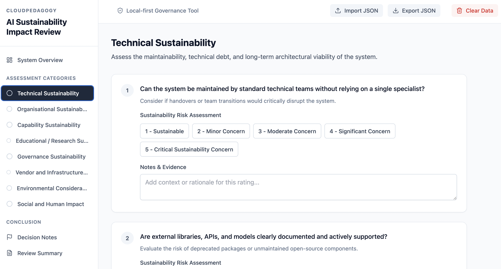

# AI Sustainability Impact Review System

## Purpose
A local-first governance tool for assessing the long-term sustainability, maintainability, resilience, and wider impact of AI-supported systems, workflows, curricula, and research projects. 

This application sits within the CloudPedagogy Governance Engineering ecosystem, helping institutions answer the core question: *Can this AI-supported system remain viable, responsible, maintainable, and governable over time?*

## 🌐 Live Hosted Version

http://cloudpedagogy-ai-sustainability-impact-review.s3-website.eu-west-2.amazonaws.com/

## 🖼️ Screenshot



## Key Features
* **Comprehensive Assessment**: Evaluate systems across Technical, Organisational, Capability, Educational, Governance, Vendor, Environmental, and Social impact dimensions.
* **Scoring Engine**: Automatically calculates sustainability risk scores from 1 (Sustainable) to 5 (Unsustainable).
* **Governance Mitigation**: Generates automated, priority mitigation strategies for high-risk categories.
* **Decision Support**: Built-in functionality for recording final governance recommendations and rationale.
* **No Database**: Entirely local-first design; all state runs directly in the browser.
* **Print / Export Support**: Generate clean, professional PDF or print summaries. Data can be exported or imported via JSON.

## Local-First Privacy Statement
> This tool runs locally in your browser. No data is sent to CloudPedagogy or any external server. 

Data is securely stored in your browser's `localStorage` and can be exported locally to JSON for documentation.

## Technology Stack
* React 19
* TypeScript
* Vite
* Tailwind CSS
* Zustand (State management)
* React Router (Hash routing for static hosting)

## Installation Instructions

Ensure you have Node.js installed, then:

```bash
git clone https://github.com/cloudpedagogy/cloudpedagogy-ai-sustainability-impact-review.git
cd cloudpedagogy-ai-sustainability-impact-review
npm install
npm run dev
```

## Build Instructions
To build for production:

```bash
npm run build
```

This will output all necessary files to the `dist/` directory.

## Static Deployment & AWS S3 Hosting
The application uses hash-based routing (`/#/summary`) specifically to avoid server-side redirect issues.

To deploy to AWS S3:
1. Run `npm run build`
2. Upload the contents of the `dist/` folder directly to an S3 bucket configured for "Static website hosting".
3. Set the Index Document to `index.html`. No Error Document configuration is strictly required, but you can set it to `index.html` as well.

## Example Use Cases
* **Initial Design Review**: Assessing a vendor-provided AI tutoring system before adoption.
* **Pre-Deployment Review**: Verifying an institutional LLM gateway has the appropriate resourcing.
* **Annual Review**: Re-evaluating existing AI workflows to check for technical debt and vendor lock-in.

## Disclaimer
> This application is provided for educational, experimental, and illustrative purposes only. It does not constitute legal, professional, technical, environmental, or institutional advice. Users remain responsible for interpreting outputs and making final decisions.

## Licence
This project is released under the MIT Licence.

Part of the CloudPedagogy Governance Engineering ecosystem.